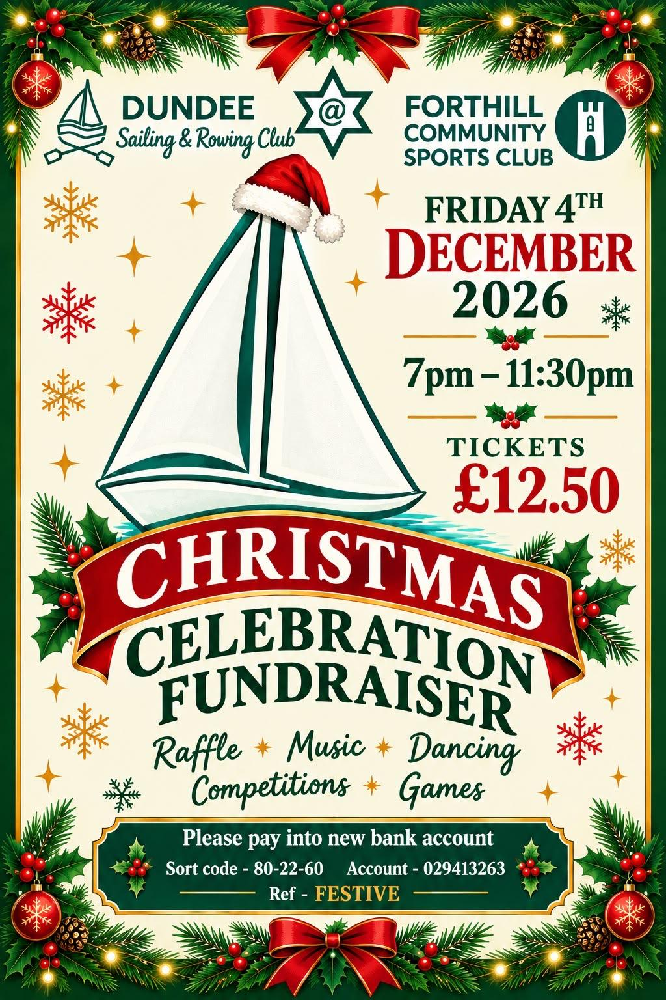

# Commodore’s Corner

Well, November already! Where has the year gone? The sailing season may be drawing to a close, but there’s certainly no slowing down at DSRC! With rowing continuing throughout the winter, training sessions, social events and Christmas festivities on the horizon, there’s plenty to keep us busy.

So, here’s a wee catch-up on what’s happening around the club.

 
# ⛵ Sailing - What a Finish!

What a fantastic end to the weekend sailing season with 18 sailors out on the water! 😊 A&nbsp;brilliant turnout and a great way to finish.

The Thursday sailors aren’t disappearing for the winter either! Fortnightly onshore sessions and theory will continue, and everyone is welcome. Details on Spond, Going Sailing WhatsApp or contact Kerstin.

# Winter Rowing - Keep Those Oars Moving!

Full details of our winter rowing sessions can be found on the club website, and additional training may be arranged depending on availability. Our winter programme offers something for everyone:

- Wednesday: Training rows, times depend on tides.
- Saturday 8:15 - 9:15am: Stamina rows for fitness and regatta preparation.
- Saturday 9:15 - 10:15am: Taster rows.
- Saturday 10:15 - 11:30am: Training rows, particularly helpful for newer rowers.

Informal rowing and coxing training can take place during regular two-hour rows. Dedicated coxing sessions have stopped for winter.

**RP training**:  Details on how to become an RP are available on the club website.

**A wee reminder**: Bring your competency booklet for signing and let the RP know what you’d like to work on.

**And to our early-morning stamina rowers @6:15am**: Please check the booking sheet for available days each week. There’s nothing quite like a refreshing start to the weekend, especially when everyone else is still tucked up in bed!

# Members’ Survey - Have Your Say!

As we reflect on the past year and look ahead, we’d love to hear everyone’s views on the club and its future. The more members who take part, the better the results will reflect the views of everyone across the club. So please take time to complete the survey. The survey closes on Sunday 8th November, which gives us time to process the results before the AGM.

**[Complete the survey here](https://forms.gle/uos3Mgz335EwXx4V6)**

# A Little Something Special

I’d like to share this lovely poem by Sarah, one of our newer members. I think it captures beautifully the friendship, laughter and sense of belonging that makes DSRC so special.

::: poem
| I came to DSRC
| pristine, dry, in purple leggings, clean
| white top. Arrived a stranger to myself,
| had never fitted in space and time. My
| body was stiff from sitting still. I left
| in squelching shoes, with creased up eyes that hurt
| from unfamiliar laughter. I left
| with sea wind in my bones, brine in my blood
| Knowing I had somewhere to belong.

Sarah Frideswide (Literary Loony)

:::

Thank you, Sarah, for sharing such lovely words.

# Forfar Regatta - Sunshine, Smiles and Medals!

::: guest-article

By Sarah Frideswide (Literary Loony)

On Saturday 17th October, a group of us went up to Forfar for the regatta. For me, taking part in my first ever regatta, it was a lot of fun. We had glorious sunshine all day, good company, good food and a bit of exercise in between. I was coxing the 280 team and they were brilliant: worked hard all around the course and someone said that we came fourth, which was phenomenal when we'd had only one chance to train with the whole team together beforehand. It was fun to put my army training to good use. I think coxing is the only activity where you can yell at people for 20 minutes straight and then they say 'thank you' afterwards! In the next race, the Open Women, Forfar cheated quite flagrantly. They don't know it yet, but we're going to exact vengeance once we've had the chance to get out on plenty of stamina rows - we'll show them what's what, only we'll do it honourably! 

Several of us joined in the mixed-club races in the afternoon. Catherine, Frances and Gil all won medals in those races. Karen and I found ourselves pitted against each other when the boat she was rowing in was trying to overtake the team I was coxing in Eider. I made sure they had to work for it; they didn't manage to catch us until just before the finish line! All in all, the day was a lot of fun and I went home hoarse, hungry and ready for bed! I suspect most of us did.
:::

# Slipway - Some Encouraging News!

We’ve had some very positive news from Dundee City Council!

Following discussions with the Council’s Property Department, we’ve received confirmation that a **99-year lease for our slipway is possible**.

We’re now working through the proposed terms, including the associated costs, with the aim of securing a long-term agreement that will allow us to seek funding for much-needed improvements to the slipway. 

There’s still work to be done, but it’s a positive step forward, and we’ll keep members updated as things progress. 

# Looking to the Future

There’s been plenty happening behind the scenes as we look towards the future of DSRC!

We’ve been working with architects on ideas for improving our clubhouse, potentially in phases, and hope to have some initial drawings on display at the AGM. These are very much early proposals, and members will have the opportunity to share their thoughts and suggestions afterwards.

Meanwhile, our fundraising group has been busy exploring potential funding opportunities for both projects.

It’s still early days, but exciting to see things moving forward!

# Dates for Your Diary

## Monday 9th November - DSRC on Bridge FM (Hospital Radio)

We’ll be chatting about the club on hospital radio. A lovely opportunity to spread the word about what we do. Further details and time will be shared on the club WhatsApp groups. 

## Sunday 22nd November - Club AGM - 2pm

A reminder of our AGM. We’re also looking for members interested in joining the committee. Fresh faces, new ideas and a little enthusiasm are always welcome. Remember, it’s your club!

## Wednesday 25th November - Derick Henderson’s Underwater Adventure - 7pm

An opportunity to hear about Derick’s diving experiences and adventures beneath the waves. Join us as he shares his underwater experience, along with photos from his adventures. **Then come back to the surface and enjoy a cuppa!** 😊

## Friday 4th December - Christmas Celebration Fundraiser 7pm - 11:30pm

  

  

&nbsp;
🎅🎄Come along for some festive fun, good company and a chance to support the club. Let’s make it a great night! **Have you got your tickets yet?** Tickets £12.50. Please come along and support your club.

Lots of fun, music, dancing, games, a raffle and lots of laughs.  

**DSRC Payment details**: Sort code: 80-22-60, Account: 29413263, Reference: FESTIVE

## January to March 2027 - Winter Evening Training

Open to sailors and rowers alike, with sessions covering weather, tides, knots, VHF radios and other useful skills. A chance to learn something new without getting your feet wet! 

**Further details on winter activities will follow.**

# And finally ...

A big thank you to everyone who continues to give their time and enthusiasm to the club. Whether you’re rowing, sailing, helping behind the scenes or simply joining in the fun, it’s the people who make DSRC what it is.

Here’s to another enjoyable winter together - and remember, if you see someone heading out rowing on a freezing morning, give them a wave. They’ve clearly forgotten how comfortable their bed was!

Happy rowing, happy sailing and keep smiling!

Yolanda

---
::: footer
{.footer-badge width=80px}

Contact: yvarchibald@gmail.com

:::
